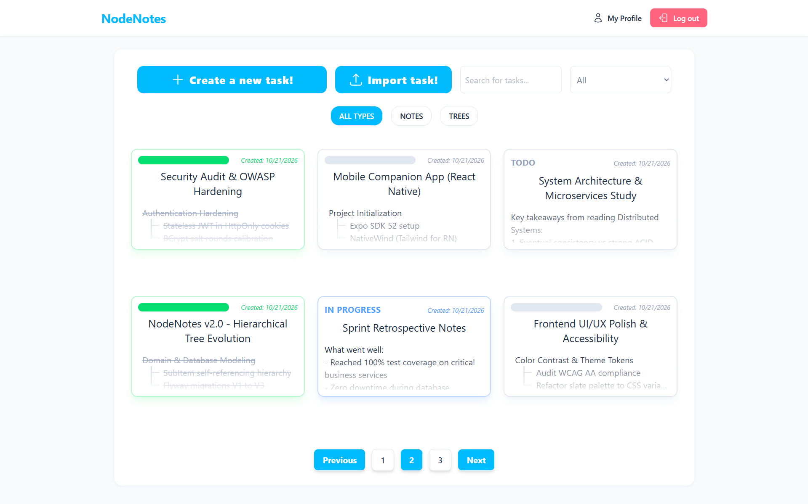
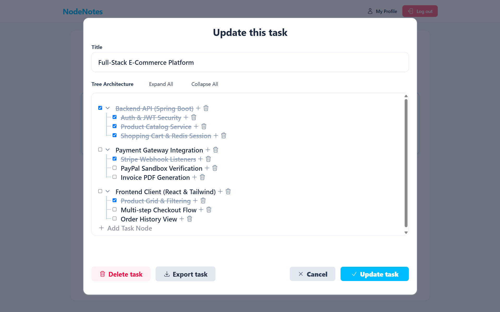
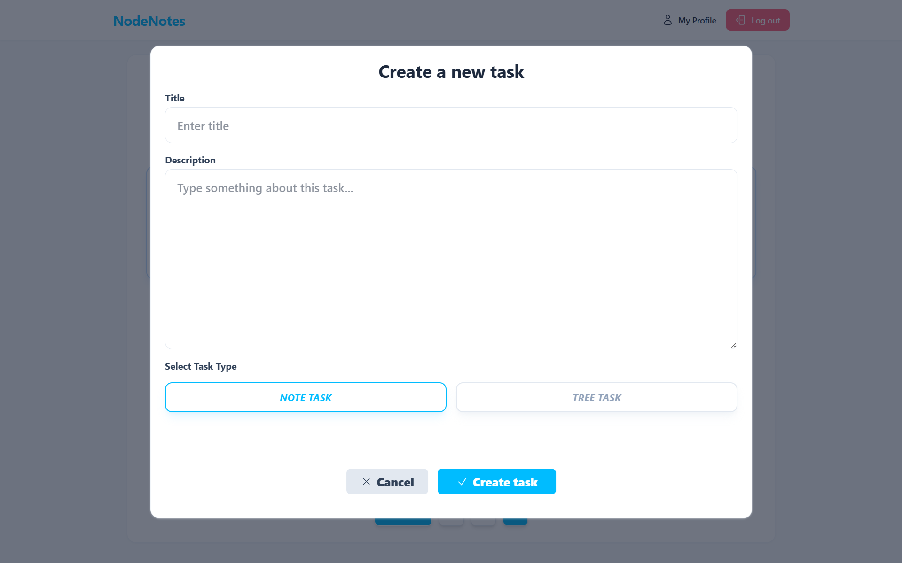
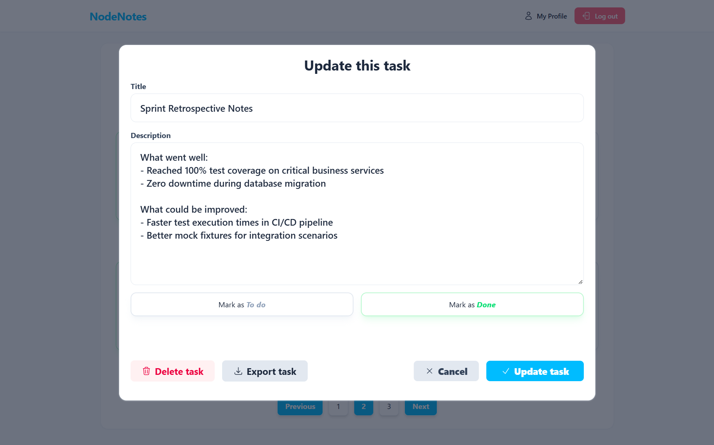
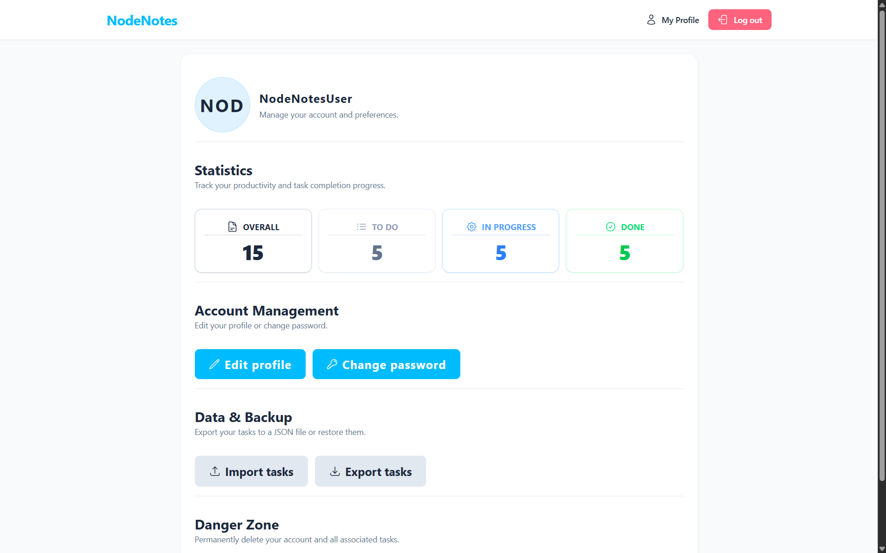
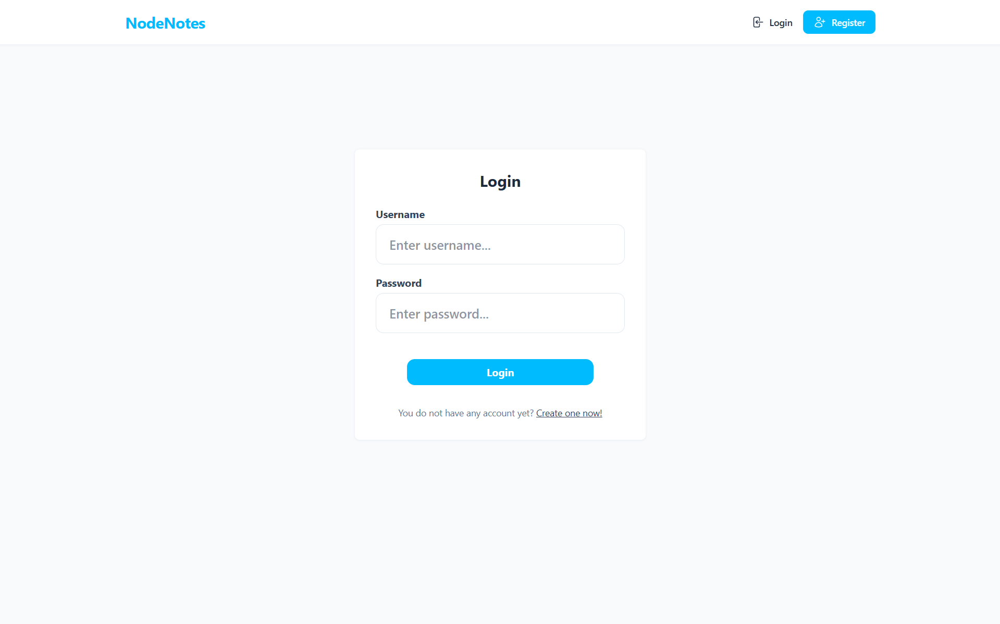

# 🌳 NodeNotes

<div align="center">


**Full-stack task & note management app with hierarchical trees, automated status calculations, and JSON backups.**

[🇬🇧 English](#-english) &nbsp; | &nbsp; [🇵🇱 Polski](#-polski)

</div>

---

<a name="english"></a>
## 🇬🇧 English

### Overview
**NodeNotes** is a task and note management application built to handle both simple everyday notes and complex, multi-level projects.

Instead of forcing everything into a single flat checklist, tasks are divided into two dedicated formats:
* **NOTE** — standard tasks with descriptions and status toggles, ideal for quick notes and everyday to-dos.
* **TREE** — interactive hierarchical trees with unlimited subtask nesting, where progress automatically recalculates up and down the branch hierarchy.

The app also features a full JSON import/export engine, allowing you to back up, share, or restore individual trees and entire profiles at any time.

---

### 📸 Screenshots

> 💡 **Demo Data Note:** The task and tree notes shown in the screenshots below were generated with AI specifically for presentation purposes and populated into the database using the app's built-in **JSON Import** feature.

<table>
  <tr>
    <th width="33.3%">Dashboard</th>
    <th width="33.3%">Tree Task Hierarchy</th>
    <th width="33.3%">Creating a Task</th>
  </tr>
  <tr>
    <td></td>
    <td></td>
    <td></td>
  </tr>
  <tr>
    <th>Note Task View</th>
    <th>User Profile & Stats</th>
    <th>Authentication</th>
  </tr>
  <tr>
    <td></td>
    <td></td>
    <td></td>
  </tr>
</table>

---

### Features

* **Hierarchical Tree Tasks:** Recursive `@OneToMany` entity structure with parent-child relationships and cascade deletions.
* **Automated Status Calculation:** 
  * Checking all subitems marks the parent done; unchecking one unmarks it.
  * Root task status automatically shifts between `TODO`, `IN_PROGRESS`, and `DONE` based on subtask completion.
* **JSON Backup & Restore:** Export individual tasks or your entire profile to clean `.json` files, and re-import them anytime with automated tree structure reconstruction.
* **Server-side Search & Filtering:** Debounced title search combined with status and type filters with pagination.
* **Secure Auth:** Stateless JWT stored in `HttpOnly` cookies, BCrypt password encryption, and full user data isolation.
* **Database Migrations:** Schema versioning managed through Flyway SQL scripts (`V1`, `V2`, `V3`).
* **Test Suite:** Unit tests for service logic and MockMvc integration tests covering controllers, security, and PostgreSQL persistence.

---

### Tech Stack

* **Backend:** Java 25, Spring Boot 4.0.6, Spring Data JPA, Hibernate 7, Spring Security 7, Flyway, JJWT, Jackson 3, Lombok.
* **Frontend:** React 19, TypeScript, Vite, Tailwind CSS, React Hook Form, Zod, Axios.
* **Database & DevOps:** PostgreSQL 16 Alpine, Docker & Docker Compose.
* **Testing:** JUnit 5, Mockito, AssertJ, MockMvc.

---

### Getting Started

You can run the full stack (PostgreSQL + Spring Boot API + React frontend) in containers using Docker Compose.

#### Prerequisites
* [Docker Desktop](https://www.docker.com/products/docker-desktop/) installed and running.

#### 1. Clone the repository
```bash
git clone https://github.com/kubaMiczuu/NodeNotes.git
cd NodeNotes
```

#### 2. Set up environment variables
Create a `.env` file based on `.env.example`:
```bash
cp .env.example .env
# Windows (CMD): copy .env.example .env
```

Default values in `.env`:
| Variable | Default Value | Description |
| :--- | :--- | :--- |
| `DB_NAME` | `nodenotes_db` | PostgreSQL database name |
| `DB_USERNAME` | `admin` | Database user |
| `DB_PASSWORD` | `admin123` | Database password |
| `JWT_SECRET` | *(32+ characters)* | HMAC-SHA secret key for signing tokens |
| `JWT_EXPIRATION` | `86400000` | Token expiration time in ms (24 hours) |

#### 3. Build and run with Docker Compose
```bash
docker-compose up -d --build
```

#### 4. Open in browser
* **Frontend:** [http://localhost:5173](http://localhost:5173)
* **Backend API:** [http://localhost:8080/api](http://localhost:8080/api)
* **Swagger UI:** [http://localhost:8080/swagger-ui.html](http://localhost:8080/swagger-ui.html)
* **PostgreSQL:** `localhost:5433` (DB: `nodenotes_db`, user: `admin`)

To stop all containers:
```bash
docker-compose down
```

---

#### Local Development (Running without Docker)

> **Prerequisites for local dev:** [JDK 25](https://jdk.java.net/25/), [Maven](https://maven.apache.org/) (or use the included wrapper: `./mvnw` / `.\mvnw.cmd`), and [Node.js 20+](https://nodejs.org/).

**Backend:**
Make sure PostgreSQL is running (e.g. `docker-compose up -d postgres`), then:
```bash
cd backend-spring

# Using the included Maven wrapper:
./mvnw clean spring-boot:run      # Linux / macOS
.\mvnw.cmd clean spring-boot:run  # Windows

# Or using globally installed Maven:
mvn clean spring-boot:run
```
To run tests:
```bash
./mvnw test       # or: mvn test
```

**Frontend:**
```bash
cd frontend-react
npm install
npm run dev
```

---
---

<a name="polski"></a>
## 🇵🇱 Polski

### O projekcie
**NodeNotes** to aplikacja do organizacji zadań i notatek, zaprojektowana z myślą zarówno o szybkich zapiskach, jak i wieloetapowych, złożonych projektach.

Zamiast upychać wszystko na jednej płaskiej liście, aplikacja dzieli zadania na dwa dedykowane formaty:
* **NOTE** — klasyczne zadania z opisem tekstowym i statusem, idealne na codzienne notatki czy szybkie to-do.
* **TREE** — interaktywne drzewa zadań z dowolną liczbą zagnieżdżeń, w których ukończenie kolejnych gałęzi automatycznie aktualizuje status nadrzędnych węzłów i całego zadania.

Całość dopełnia silnik importu i eksportu JSON, pozwalający w każdej chwili pobrać lub wgrać kopię zapasową pojedynczego drzewa albo całego konta.

---

### 📸 Zrzuty ekranu

> 💡 **Informacja o danych demonstracyjnych:** Zadania i drzewa widoczne na poniższych zrzutach ekranu zostały wygenerowane przy pomocy AI na potrzeby prezentacji projektu i zaimportowane do bazy danych przy użyciu wbudowanej funkcji **Importu JSON**.

<table>
  <tr>
    <th width="33.3%">Główny Dashboard</th>
    <th width="33.3%">Hierarchia Drzewa</th>
    <th width="33.3%">Tworzenie Zadania</th>
  </tr>
  <tr>
    <td></td>
    <td></td>
    <td></td>
  </tr>
  <tr>
    <th>Widok Zwykłej Notatki</th>
    <th>Profil i Statystyki</th>
    <th>Logowanie i Rejestracja</th>
  </tr>
  <tr>
    <td></td>
    <td></td>
    <td></td>
  </tr>
</table>

---

### Funkcjonalności

* **Zadania Drzewiaste (TREE):** Relacja rekurencyjna w JPA (`@OneToMany` / `@ManyToOne`), pozwalająca tworzyć podzadania podzadań z kaskadowym usuwaniem.
* **Automatyczne Przeliczanie Statusów:**
  * Zaznaczenie wszystkich dzieci oznacza rodzica jako wykonanego; odznaczenie jednego cofa stan rodzica.
  * Status głównego zadania przelicza się na bieżąco (`TODO`, `IN_PROGRESS`, `DONE`).
* **Import i Eksport JSON:** Eksport pojedynczych zadań z poziomu modalu lub całego konta z profilu, z automatyczną odbudową hierarchii podczas importu.
* **Filtrowanie i Paginacja Serwerowa:** Wyszukiwanie z debouncingiem połączone z filtrami statusu i typu.
* **Bezpieczeństwo:** Bezstanowe tokeny JWT w ciasteczkach `HttpOnly`, hasła szyfrowane przez BCrypt, izolacja danych między użytkownikami.
* **Wersjonowanie Bazy (Flyway):** Wszystkie zmiany w strukturze tabel opisane w skryptach migracji (`V1`, `V2`, `V3`).
* **Zestaw Testów:** Testy jednostkowe serwisów oraz testy integracyjne MockMvc z realną bazą PostgreSQL i Spring Security.

---

### Stos Technologiczny

* **Backend:** Java 25, Spring Boot 4.0.6, Spring Data JPA, Hibernate 7, Spring Security 7, Flyway, JJWT, Jackson 3, Lombok.
* **Frontend:** React 19, TypeScript, Vite, Tailwind CSS, React Hook Form, Zod, Axios.
* **Baza Danych & DevOps:** PostgreSQL 16 Alpine, Docker & Docker Compose.
* **Testy:** JUnit 5, Mockito, AssertJ, MockMvc.

---

### Instrukcja Uruchomienia (Krok po Kroku)

Całość (PostgreSQL + Spring Boot API + frontend React) uruchamia się automatycznie przez Docker Compose.

#### Wymagania
* Zainstalowany [Docker Desktop](https://www.docker.com/products/docker-desktop/).

#### 1. Klonowanie repozytorium
```bash
git clone https://github.com/kubaMiczuu/NodeNotes.git
cd NodeNotes
```

#### 2. Konfiguracja pliku .env
Skopiuj `.env.example` do `.env`:
```bash
cp .env.example .env
# Windows (CMD): copy .env.example .env
```

Domyślne wartości w `.env`:
| Zmienna | Wartość domyślna | Opis |
| :--- | :--- | :--- |
| `DB_NAME` | `nodenotes_db` | Nazwa bazy PostgreSQL |
| `DB_USERNAME` | `admin` | Użytkownik bazy danych |
| `DB_PASSWORD` | `admin123` | Hasło użytkownika |
| `JWT_SECRET` | *(min. 32 znaki)* | Klucz HMAC-SHA do podpisywania tokenów |
| `JWT_EXPIRATION` | `86400000` | Czas ważności sesji w ms (24h) |

#### 3. Start kontenerów
```bash
docker-compose up -d --build
```

#### 4. Dostęp do aplikacji
* **Frontend:** [http://localhost:5173](http://localhost:5173)
* **Backend API:** [http://localhost:8080/api](http://localhost:8080/api)
* **Dokumentacja Swagger:** [http://localhost:8080/swagger-ui.html](http://localhost:8080/swagger-ui.html)
* **Baza PostgreSQL:** `localhost:5433` (baza: `nodenotes_db`, user: `admin`)

Zatrzymanie kontenerów:
```bash
docker-compose down
```

---

#### Uruchomienie Lokalne (Development bez Dockera)

> **Wymagania:** Zainstalowane [JDK 25](https://jdk.java.net/25/), [Maven](https://maven.apache.org/) (lub skorzystanie z dołączonego wrappera: `./mvnw` / `.\mvnw.cmd`) oraz [Node.js 20+](https://nodejs.org/).

**Backend:**
Uruchom bazę (np. `docker-compose up -d postgres`), a następnie:
```bash
cd backend-spring

# Przy użyciu dołączonego wrappera Maven:
./mvnw clean spring-boot:run      # Linux / macOS
.\mvnw.cmd clean spring-boot:run  # Windows

# Lub przy użyciu zainstalowanego Mavena:
mvn clean spring-boot:run
```
Uruchomienie testów:
```bash
./mvnw test       # lub: mvn test
```

**Frontend:**
```bash
cd frontend-react
npm install
npm run dev
```

---

<div align="center">
Jakub Miczek &bull; NodeNotes
</div>
